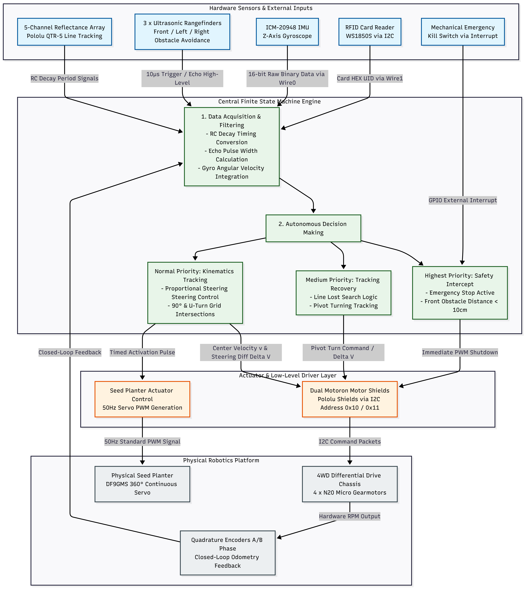
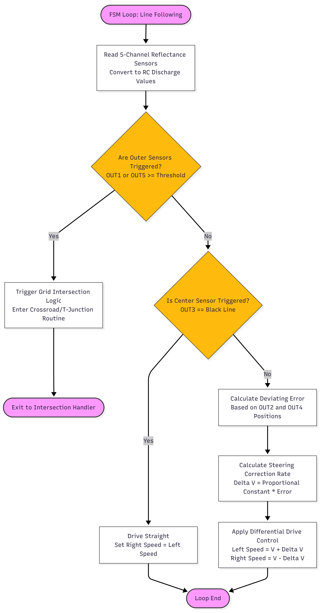
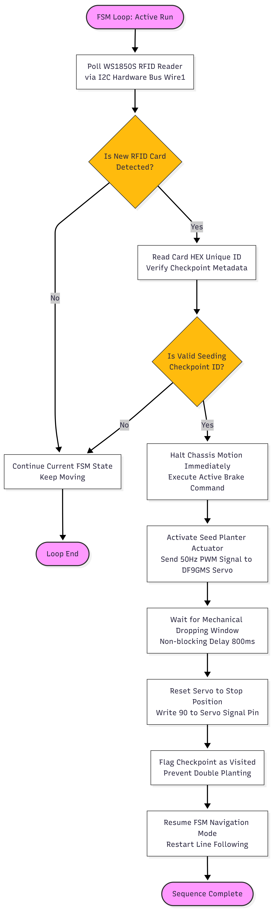
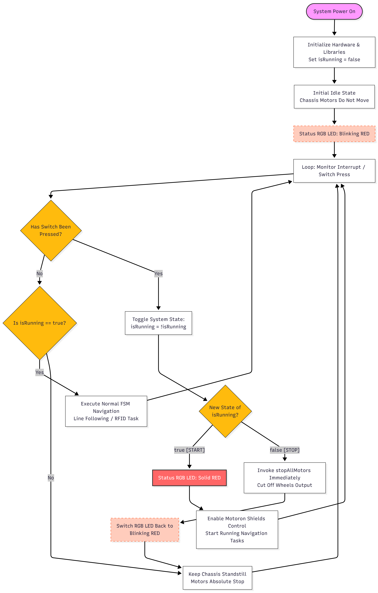

# Autonomous Terraforming Robot

A line-following, RFID-aware robot that explores a gridded arena, asks a game server which fields are fertile, plants seeds in them, and drives itself back to base when an emergency is declared. Built on an Arduino GIGA R1 WiFi with PlatformIO, as a UCL team project.



## Team

Built by Timeo Ayme ([@timeoayme](https://github.com/timeoayme)) together with three teammates, as a UCL team project.

## What the Robot Does

1. **Waits in a safe state.** It boots stopped and only moves after the mechanical run toggle (D45) is pressed.
2. **Follows the black line** using a 5-channel reflectance array and PID steering.
3. **Handles the grid.** It detects corners, T-junctions and dead ends, and makes IMU-guided 90° and 180° turns.
4. **Recovers when the line is lost** with short search turns, yaw-hold driving, or ultrasonic wall following in tunnels.
5. **Reads RFID tags** as checkpoints. The first tag is the airlock; later tags trigger a fertility query to the server.
6. **Plants seeds** with a continuous-rotation servo, but only after the server confirms the field is fertile and not already planted. It then reports `seedPlanted`.
7. **Returns to base** on an emergency command, planning a route to the grid exit at `(9, 7)`.

## Hardware

| Part | Role |
| --- | --- |
| Arduino GIGA R1 WiFi | Main controller |
| Pololu QTR-5 reflectance array | Line tracking (RC-decay timing) |
| 3× ultrasonic rangefinders (front, left, right) | Obstacle detection and tunnel wall following |
| ICM-20948 IMU | Gyro-integrated yaw for turns and heading hold |
| WS1850S RFID reader (I²C, `0x28`) | Checkpoint and tag identification |
| 2× Pololu Motoron shields (I²C, `0x10` and `0x11`) | Motor drivers |
| 4WD chassis with 4× N20 gearmotors and quadrature encoders | Drive and odometry |
| DF9GMS 360° continuous servo | Seed planter |
| Mechanical kill switch (D45), revive button (D32), red/green status LEDs | Safety and status |

## Repository Contents

| Path | Description |
| --- | --- |
| `final.cpp` | Main integrated controller (the `main.cpp` of the PlatformIO project) |
| `planting.cpp` | Standalone field-planting controller (`pre_emergency_planting` environment) |
| `return_to_base.cpp` | Standalone emergency-return test (`back_to_base` environment) |
| `platform_io` | Exported `platformio.ini` with all build environments |
| `secrets.example.h` | Template for private network and server settings |
| `software_overview_diagram.png` | System architecture diagram |
| `flowcharts/` | Flowcharts for line following, RFID planting and the mechanical kill switch |
| `Testing_Calibration_Evidence/` | Serial logs from test runs |

The source files in this repo are exports from the full PlatformIO project, which is split into one `src/` file per behaviour. To rebuild it, create a PlatformIO project, copy `platform_io` to `platformio.ini`, and place the `.cpp` files in `src/` under the names the environments expect (`final.cpp` becomes `main.cpp`).

## Getting Started

### Prerequisites

- [PlatformIO](https://platformio.org/) (CLI or VS Code extension)
- An Arduino GIGA R1 WiFi connected over USB-C
- Access to the challenge server's network for online mode

Library dependencies are installed automatically from `lib_deps`:

| Library | Purpose |
| --- | --- |
| `motoron-arduino` (Pololu) | Motor controller communication |
| `MFRC522_I2C` | RFID reader |
| SparkFun ICM-20948 library | IMU |
| `ArduinoMqttClient` | MQTT transport |
| `MiniMessenger` | Challenge-server messaging |
| `Servo` | Seed planter servo |

### Configure private settings

The firmware includes a `secrets.h` that is deliberately **not** committed. Copy the template and fill in your own values:

```bash
cp secrets.example.h secrets.h
```

```cpp
#define WIFI_SSID     "YOUR_WIFI_SSID"
#define WIFI_PASSWORD "YOUR_WIFI_PASSWORD"
#define BROKER_HOST   "YOUR_BROKER_IP"
#define BROKER_PORT   1883
#define GROUP_ID      "YOUR_GROUP_ID"
#define BOARD_ID      "YOUR_BOARD_ID"
```

`secrets.h` is listed in `.gitignore`, so your credentials will not be committed by accident.

### Build and upload

```bash
pio run                        # compile the default environment (giga_r1_m7, the main controller)
pio run -t upload              # upload it
pio run -e back_to_base -t upload             # upload the emergency-return test
pio run -e pre_emergency_planting -t upload   # upload the planting controller
```

Open the serial monitor at 115200 baud (the port differs per computer; `pio device list` shows what is connected):

```bash
pio device monitor --baud 115200
```

The exported `platform_io` file sets `monitor_port` to a macOS path (`/dev/cu.usbmodem101`). Change it for your machine.

### Pre-run checklist

1. Put the robot on a safe surface with the driven wheels clear of the ground.
2. Connect USB-C and open the serial monitor.
3. Keep the robot still during IMU gyro and tilt calibration.
4. Check the startup log for the IMU, both Motoron controllers (`0x10`, `0x11`), the RFID reader (`0x28`), the ultrasonic sensors, the reflectance array and the encoders.
5. Confirm the red LED shows the stopped safety state, then press **D45** once to allow movement. **D45** toggles between stopped and running; **D32** revives after manual intervention.
6. In online mode, stay on the lab network and check that the server dashboard's enable and disable commands work before a full run.

## How It Works

### Control loop

The controller runs one non-blocking service loop. `serverMessenger.loop()` must be called every pass so that emergency, disable, heartbeat, airlock and fertility messages are handled promptly.

```text
Safety wait for D45
  → initialise hardware and communications
  → main loop:
      process server messages → read safety buttons → update LEDs
      → read reflectance sensors, encoders, IMU yaw, RFID, ultrasonics
      → run navigation → run planting → handle emergency return
```

Behaviour is prioritised: safety and emergency handling first, line-loss recovery second, normal line following and grid turns last.

### Navigation

- **Line following:** PID steering on the estimated line position (`error = target - measured`), adjusting relative motor speeds.
- **Junctions:** corners, T-junctions, dead ends and line loss are classified from the reflectance array, then resolved with IMU-guided 90° left, 90° right or 180° turns.
- **Line-loss recovery:** a short search turn, then yaw-hold driving, then ultrasonic wall following, then a recovery turn based on the last known line direction.
- **Uphill handling:** IMU tilt, roll and pitch thresholds detect slopes so the controller can adapt to them.

### RFID and planting

```text
RFID tag detected
  → send isFertile request
  → wait for isFertileReply
      ├── fertile=false or planted=true → continue navigating
      └── fertile=true and planted=false
            → run servo planting cycle → send seedPlanted
```

The robot never plants without a positive server reply.

### Emergency return

On an emergency command the robot stops its current action, works out its grid position and heading, plans a route to `(9, 7)`, and drives back while continuing to service safety and server messages. Emergency handling takes priority over line following, RFID handling and planting.

### Server protocol

Outgoing messages:

| Message | Purpose |
| --- | --- |
| `register` | Register the robot with the challenge server |
| `openAirlock` | Request access through the airlock checkpoint |
| `isFertile` | Ask whether the current RFID field is fertile |
| `seedPlanted` | Report a completed planting action |

Incoming messages:

| Message | Purpose |
| --- | --- |
| `heartbeat` | Current server-enabled state |
| `disable` | Enable or disable the robot remotely |
| `emergency` | Start or clear emergency behaviour |
| `openAirlockReply` | Whether the airlock request was accepted |
| `isFertileReply` | Fertility, planting state and grid coordinates |

## Flowcharts

| Line following | RFID planting | Mechanical kill switch |
| --- | --- | --- |
|  |  |  |

## Testing and Calibration

`Testing_Calibration_Evidence/Logs_Terminal` is a serial capture from an integration run, showing sensor readings, state transitions (`CORRECT_LEFT`, `FORWARD_PULSE`, ...) and ultrasonic and yaw data.

## Known Limitations

- Performance depends on reflectance and ultrasonic calibration for the test environment.
- IMU drift can reduce turning accuracy over long runs.
- RFID and server replies arrive asynchronously, which adds delay.
- Network loss prevents online checkpoint handling.
- Line-loss recovery depends on the robot's previous direction and the surrounding geometry.
- Emergency route planning assumes the robot's internal grid position is still accurate.
